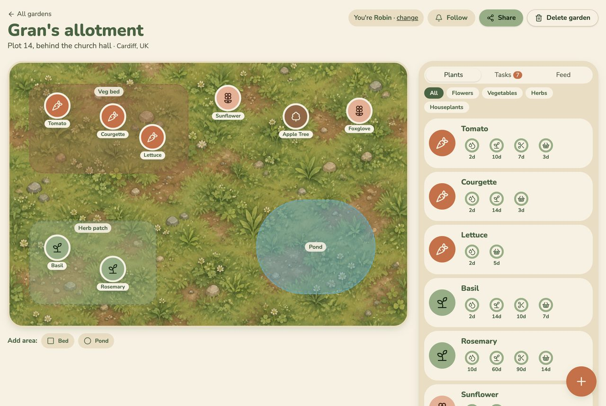

# Fernslop

**Shared garden plans that anyone can help tend.**

I wanted an app that reminded me when my plants needed watering or feeding, and showed where everything was. It grew into shared gardens: a family, flatmates or a community group all looking after the same space, from one link, with no accounts.

**Live:** Production: <URL> · Development: <URL>



## What this repo provides

| Area | What is here | Details |
| --- | --- | --- |
| Problem and behaviour | What the app is for, what it does, how it should behave | [What it does](#what-it-does) · [Product guide](docs/product.md) |
| Spec and task tracker | A build spec, and one Markdown issue per task with acceptance criteria and a QA verdict | [Agent team](#how-it-was-built-an-agent-team) |
| Agent team | Five roles with their own briefs, and a process for how they work together | [Agent team](#how-it-was-built-an-agent-team) · [`_docs/process.md`](_docs/process.md) |
| Agent context | `AGENTS.md` with the commands and links to the process and role docs | [`AGENTS.md`](AGENTS.md) |
| Application | React frontend, FastAPI backend, PostgreSQL | [Quick start](#quick-start) · [Architecture](docs/architecture.md) |
| Tests | Unit, integration and end-to-end tests, one command | [Tests](#tests) · [Getting started](docs/getting-started.md#4-run-the-tests) |
| Containers | App, database and monitoring stack with Docker Compose, one command | [Quick start](#quick-start) |
| Deployment | Dev and prod on AWS, behind HTTPS | [Deployment](#deployment) · [Deployment guide](docs/deployment.md) |
| CI/CD | Tests on every pull request, automatic deploy to dev, manual promotion to prod | [Deployment](#deployment) |
| Observability | Traces, metrics and logs that share a trace ID, viewed in Grafana | [Observability](#observability-alerting-and-on-call) · [Guide](docs/observability.md) |
| Alerting | An alert when users can't find the plant they want to add | [Observability](#observability-alerting-and-on-call) · [Alert](docs/observability.md#alerting-on-user-impact) |
| On-call agent | Wakes on an alert, fixes it on a branch or files a GitHub issue | [Observability](#observability-alerting-and-on-call) · [On-call agent](docs/observability.md#on-call-agent) |

## What it does

- **Shared gardens:** create one and share its link. Anyone with it can edit, and changes show up live.
- **Garden canvas:** drag plants to where they grow, and mark areas like a pond or a veg bed.
- **Find plants:** search about 50 common plants by name, or identify one from a photo.
- **Care rings:** countdowns for watering, feeding, pruning and harvesting each plant.
- **Feed and Undo:** every change is logged, and plant and area changes can be undone.
- **Weekly email:** follow a garden by email and get a summary.
- **Works on phones:** nothing needs dragging.

### Expected behaviour

| When you... | Fernslop... |
| --- | --- |
| Create a garden | Opens it and offers a link to share |
| Add a plant by search or photo | Asks you to confirm it, then places it in the middle of the canvas |
| Drag a plant or area | Saves it and shows the move to everyone else live |
| Mark a plant watered | Resets its ring and posts to the feed |
| Click **Undo** in the feed | Reverts that change, unless a later change touched the same thing |
| Add a 51st plant or an 11th area | Says the garden is full and adds nothing |
| Search for a plant that isn't in the table | Records the miss. Repeated misses raise an alert |
| Go too fast | Says "You're going a bit fast. Try again in N seconds." |

The full list, with screenshots, is in the [product guide](docs/product.md).

## Quick start

You need Docker (with Compose v2), [uv](https://docs.astral.sh/uv/), Node.js 24 and `make`.

```sh
git clone https://github.com/Dakini/fernslop.git
cd fernslop
make up
```

This builds the image and starts the app, PostgreSQL and the monitoring stack.

- App: http://localhost:8000 (three demo gardens are already there)
- Grafana: http://localhost:3000

`make down` stops everything and keeps the data. `make delete` also deletes the database. To run the backend and frontend separately with live reload, see [Getting started](docs/getting-started.md#3-run-for-development).

Stack: React 19, FastAPI, PostgreSQL, Docker Compose, AWS, OpenTelemetry, Grafana.

## Tests

```sh
make test-all
```

This runs the backend tests (pytest: unit tests, plus every API route against a real database), the frontend tests (Vitest) and the end-to-end tests (Playwright, two browsers against a throwaway Docker stack). CI runs all three on every pull request. Details are in [Getting started](docs/getting-started.md#4-run-the-tests).

## Deployment

```
pull request ──▶ tests ──▶ merge to main ──▶ build image ──▶ deploy to dev (automatic)
                                                                   │
                                          "Promote to prod" (manual) ──▶ deploy the same image to prod
```

Dev and prod each run on an AWS EC2 server, defined in CloudFormation. GitHub Actions deploys with OIDC, so no AWS keys are stored. See the [deployment guide](docs/deployment.md), and [`infra/README.md`](infra/README.md) for every setup command.

## Observability, alerting and on-call

- **Telemetry:** traces, metrics and structured logs from OpenTelemetry. They share a trace ID, and you view them in Grafana. No request bodies, headers or personal data are sent.
- **Alerting:** an alert fires when people keep searching for a plant the app doesn't have, because they can't add it.
- **On-call agent:** a script checks the alerts every minute. It hands each new alert to a coding agent, which fixes it on a branch or files a GitHub issue for a person.

See [Observability, alerts and on-call](docs/observability.md).

## How it was built: an agent team

A team of AI agents built Fernslop, working from a written spec and a task tracker.

| Role | Does | Brief |
| --- | --- | --- |
| Orchestrator | Sizes each request, runs the other roles, closes issues after QA passes | [`_docs/process.md`](_docs/process.md) |
| Task manager | Turns a request into issues | [`tm.md`](_docs/team/tm.md) |
| Product manager | Grooms an issue: goal, acceptance criteria, scope | [`pm.md`](_docs/team/pm.md) |
| Software engineer | Implements one groomed issue | [`software-engineer.md`](_docs/team/software-engineer.md) |
| QA engineer | Checks the result against the acceptance criteria: PASS or FAIL | [`qa-engineer.md`](_docs/team/qa-engineer.md) |

- **Spec:** [`_docs/plan.md`](_docs/plan.md) is the first plan. [`_docs/lovable-spec.md`](_docs/lovable-spec.md) is the full build spec. [`audit.md`](audit.md) is a review that led to follow-up issues.
- **Task tracker:** [`backlog/`](backlog/) has one file per issue, in [`done/`](backlog/done/) and [`parked/`](backlog/parked/). Each has a goal, acceptance criteria, the engineer's notes and the QA verdict. Example: [`222-photos-daily-photo-cap.md`](backlog/done/222-photos-daily-photo-cap.md). Problems the on-call agent can't fix become [GitHub issues](https://github.com/Dakini/fernslop/issues?q=label%3Aon-call) labelled `on-call`.
- **Agent context:** [`AGENTS.md`](AGENTS.md), loaded through `CLAUDE.md`. Project skills are in [`.claude/skills/`](.claude/skills/), such as `design-check`, which screenshots the UI at phone, tablet and desktop sizes.

## Repository layout

```
backend/            FastAPI app, tests, seed data           (Python, uv)
frontend/           React app and tests                     (Node, Vite)
e2e/                Playwright end-to-end tests
infra/              CloudFormation templates and deploy scripts
observability/      Collector, Tempo, Prometheus, Loki, Grafana (dashboards, alerts)
on-call-engineer/   Alert poller that hands alerts to a coding agent
.github/workflows/  CI and promotion to prod
docs/               Guides: product, getting started, architecture, deployment, observability
_docs/              Spec, process and agent-team briefs
backlog/            Task tracker
openapi.yaml        API contract
Makefile            Every command above
```

## Known limitations

- Emails are printed to the console, not sent yet ([`110-api-email-sender.md`](backlog/parked/110-api-email-sender.md)).
- Live updates assume one backend process ([`090-api-live-multi-worker.md`](backlog/parked/090-api-live-multi-worker.md)).
- There are no database migrations yet ([`140-db-migrations.md`](backlog/parked/140-db-migrations.md)).
- There are no accounts or private gardens, by design. The feed and Undo are the safeguards.
