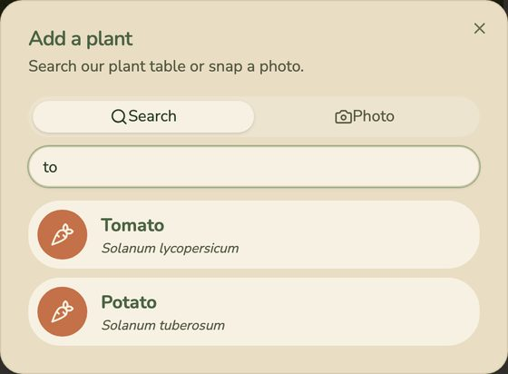
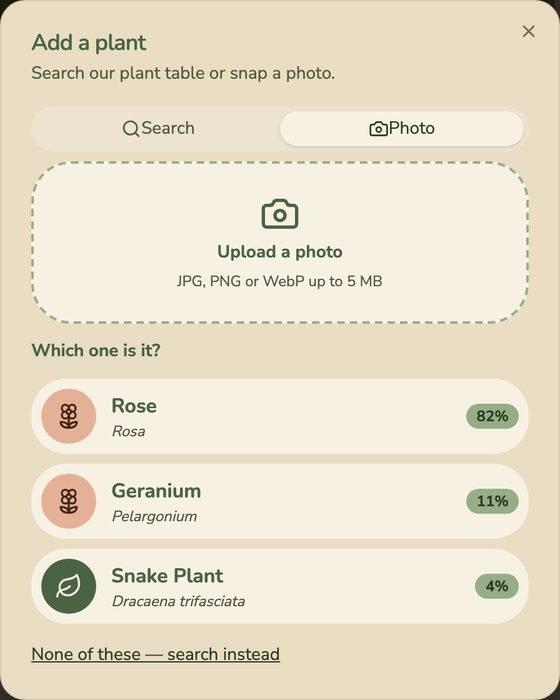

# Fernslop

**Shared garden plans that anyone can help tend.**

Create a garden, find plants by name or from a photo, and place them on a map of the real space, next to the pond, the veg bed or the herb patch. Everyone with the link sees changes live, gets care reminders, and can undo mistakes. No accounts needed.

| | |
| --- | --- |
| **Try it** | Production: <URL> · Development: <URL> |
| **Run it** | `make up`, then open http://localhost:8000 |
| **Test it** | `make test-all` |
| **Stack** | React 19 · FastAPI · PostgreSQL · Docker Compose · AWS · OpenTelemetry · Grafana |


## Why Fernslop

Most gardens are looked after by more than one person: a family, flatmates, allotment neighbours, a community group. Nobody has the whole picture:

- What is planted where?
- What is that plant called, and how do I look after it?
- What needs doing this week, and has someone already done it?

Most garden apps make every helper sign up, and keep each person's plants private to them. Fernslop gives each real garden **one shared, living plan**, opened from a link.

Read more in the [product guide](docs/product.md), which covers the problem, who it is for, every feature, and the expected behaviour in detail.

## Features

| | |
| --- | --- |
| **Shared gardens** | Create a garden and share its link. All gardens are listed on the home page. |
| **Garden canvas** | Drag plants to where they grow. Add labelled areas such as ponds and beds. |
| **Plant search** | Search about 50 common plants by common or scientific name. |
| **Photo identification** | Upload a photo, get up to 3 matches with confidence, and confirm the right one. |
| **Care rings** | Countdowns for water, feed, prune and harvest, from each plant's data. |
| **Activity feed and Undo** | Every change is logged. Plant and area changes can be undone. Post updates and photos. |
| **Live updates** | Changes show up for everyone on the page without reloading. |
| **Follow by email** | Confirm once, then get a weekly summary. Unsubscribe in one click. |
| **Mobile first** | Works on phones; every canvas action also works without dragging. |

<table>
  <tr>
    <td width="50%"><br><sub>Search by common or scientific name</sub></td>
    <td width="50%"><br><sub>Identify from a photo, then confirm</sub></td>
  </tr>
</table>

## Expected behaviour at a glance

| When you... | Fernslop... |
| --- | --- |
| Create a garden | Opens it and offers a link to share |
| Add a plant by search or photo | Asks you to confirm it, then places it in the middle of the canvas |
| Drag a plant or area | Saves it and shows the move to everyone else live |
| Mark a plant watered | Resets its ring and posts to the feed |
| Click **Undo** in the feed | Reverts that change, unless a later change touched the same thing |
| Add a 51st plant or an 11th area | Says the garden is full and adds nothing |
| Search for a plant that isn't in the table | Records the miss; repeated misses raise an alert for the team |
| Go too fast | Says "You're going a bit fast. Try again in N seconds." |

The full list is in the [product guide](docs/product.md#expected-behaviour).

## Quick start

**Prerequisites:** Docker (with Compose v2), [uv](https://docs.astral.sh/uv/), Node.js 24 and `make`.

```sh
git clone https://github.com/Dakini/fernslop.git
cd fernslop
make up
```

That one command builds the image and starts the app, PostgreSQL, and the observability stack.

- App: http://localhost:8000 (three demo gardens are seeded)
- Grafana: http://localhost:3000

`make down` stops everything and keeps the data. `make delete` also deletes the database.

To run the backend and frontend on their own with reload, see [Getting started](docs/getting-started.md#3-run-for-development).

## Tests

```sh
make test-all
```

| Suite | Command | Tool | Covers |
| --- | --- | --- | --- |
| Backend | `make test` | pytest | Unit tests, and integration tests of every API route against a real database |
| Frontend | `make test-frontend` | Vitest | Components, the services layer and helpers |
| End to end | `make test-e2e` | Playwright | Two browsers against a throwaway Docker stack: sharing a garden live, posting a photo, a missing page |

CI runs all three on every pull request and every push to `main`.

## Deployment

```
pull request ──▶ tests ──▶ merge to main ──▶ build image ──▶ deploy to dev (automatic)
                                                                   │
                                          "Promote to prod" (manual) ──▶ deploy the same image to prod
```

Dev and prod each run on an AWS EC2 server, defined in CloudFormation, behind HTTPS. GitHub Actions deploy to them with OIDC, so no AWS keys are stored. See [Deployment](docs/deployment.md), with every setup command in [`infra/README.md`](infra/README.md).

## Observability and on-call

- **Telemetry:** traces, metrics and structured logs via OpenTelemetry. They share a trace ID, and are stored in Tempo, Prometheus and Loki and viewed in Grafana. No request bodies, headers or personal data are sent.
- **Alerting:** an alert fires when people keep searching for a plant the app doesn't have, because those users can't add their plant.
- **On-call agent:** a script polls the alerts every minute. It hands each new one to a coding agent in its own git worktree, which fixes it on a branch or files a GitHub issue for a person.

See [Observability, alerts and on-call](docs/observability.md).

## How it was built: an agent team

Fernslop was built by a team of AI agents with defined roles, working from a written spec and a task tracker.

| Role | Responsibility | Brief |
| --- | --- | --- |
| Orchestrator | Sizes each request, runs the other roles, closes issues only after QA passes | [`_docs/process.md`](_docs/process.md) |
| Task manager (TM) | Turns a user request into issues | [`_docs/team/tm.md`](_docs/team/tm.md) |
| Product manager (PM) | Grooms an issue: goal, acceptance criteria, scope, constraints | [`_docs/team/pm.md`](_docs/team/pm.md) |
| Software engineer | Implements one groomed issue and documents what changed | [`_docs/team/software-engineer.md`](_docs/team/software-engineer.md) |
| QA engineer | Checks the result against the acceptance criteria and outputs PASS or FAIL | [`_docs/team/qa-engineer.md`](_docs/team/qa-engineer.md) |

**Spec:** [`_docs/lovable-spec.md`](_docs/lovable-spec.md) is the build spec. [`_docs/plan.md`](_docs/plan.md) is the first MVP plan, and [`audit.md`](audit.md) is a review that led to follow-up issues.

**Task tracker:** [`backlog/`](backlog/) has one Markdown file per issue: 67 in [`done/`](backlog/done/) and 16 in [`parked/`](backlog/parked/). Each issue has a goal, acceptance criteria, the engineer's notes and the QA verdict. For example, see [`222-photos-daily-photo-cap.md`](backlog/done/222-photos-daily-photo-cap.md). Problems the on-call agent can't fix are filed as [GitHub issues](https://github.com/Dakini/fernslop/issues?q=label%3Aon-call) labelled `on-call`.

**Agent context:** [`AGENTS.md`](AGENTS.md) (loaded through `CLAUDE.md`) gives agents the project commands and points them to the modular docs. Project skills are in [`.claude/skills/`](.claude/skills/), for example `design-check`, which screenshots the UI at phone, tablet and desktop sizes.

## Repository layout

```
backend/            FastAPI app, tests, seed data           (Python, uv)
frontend/           React single-page app and tests         (Node, Vite)
e2e/                Playwright end-to-end tests
infra/              CloudFormation templates and deploy scripts
observability/      Collector, Tempo, Prometheus, Loki, Grafana (dashboards, alerts)
on-call-engineer/   Alert poller that hands alerts to a coding agent
.github/workflows/  CI (tests, build, deploy to dev) and promotion to prod
docs/               Guides for users and operators (this README links them)
_docs/              Spec, process and agent-team briefs
backlog/            Task tracker: done/ and parked/ issues
openapi.yaml        API contract
Dockerfile          One image: built frontend plus backend
docker-compose.yaml App and PostgreSQL
Makefile            Every command above
```

## Documentation

| Guide | Read it to... |
| --- | --- |
| [Product guide](docs/product.md) | Understand the problem, the features and the expected behaviour |
| [Getting started](docs/getting-started.md) | Set up, run, configure and test it, and fix common problems |
| [Architecture](docs/architecture.md) | See how the parts fit, the data model and a request end to end |
| [Deployment](docs/deployment.md) | Deploy it to AWS, and see how CI/CD and promotion work |
| [Observability, alerts and on-call](docs/observability.md) | Follow a request through telemetry, see the alert, and run the on-call agent |
| [Testing guidelines](_docs/testing-guidelines.md) | Write tests the way this project does |
| [Design system](_docs/design-system.md) | Keep the UI consistent |

## Known limitations

- Emails are printed to the console, not sent yet ([`110-api-email-sender.md`](backlog/parked/110-api-email-sender.md)).
- Live updates assume one backend process ([`090-api-live-multi-worker.md`](backlog/parked/090-api-live-multi-worker.md)).
- There are no database migrations yet ([`140-db-migrations.md`](backlog/parked/140-db-migrations.md)).
- There are no accounts or private gardens, by design. The feed and Undo are the safeguards.
