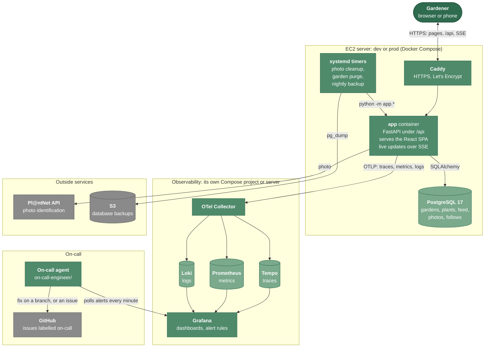

# Architecture

How the parts of Fernslop fit together.

## Overview

Dark green is the gardener, mid green is what this repo runs, light green stores data, and grey is an outside service. Locally, `make up` runs the same app and database without Caddy or the timers, and the observability stack beside them.

One Docker image holds both the built frontend and the backend. The backend serves the frontend and the API from the same origin, so there is no CORS setup in production.

## Components

| Component | Folder | Technology | Role |
| --- | --- | --- | --- |
| Frontend | `frontend/` | React 19, TanStack Router and Query, Tailwind 4, Vite | All UI. Every backend call goes through one services layer (`src/services/`), which has an HTTP version and an in-browser mock |
| Backend | `backend/app/` | Python 3.12, FastAPI, SQLAlchemy 2, Pillow | REST API, validation, rate limits, photo checks, live updates, scheduled jobs |
| Database | | PostgreSQL 17 (SQLite for local dev and tests) | Gardens, plants, areas, feed, photos, follows |
| Live updates | `backend/app/live.py` | Server-Sent Events | Tells every open browser of a garden when something changed |
| Photo identification | `backend/app/identify.py` | Pl@ntNet API, or a stub | Turns a photo into up to 3 plant candidates |
| Telemetry | `backend/app/telemetry.py`, `metrics.py` | OpenTelemetry SDK | Traces, metrics and logs |
| Observability stack | `observability/` | OTel Collector, Tempo, Prometheus, Loki, Grafana | Stores the telemetry, and shows dashboards and alerts |
| Infrastructure | `infra/` | AWS CloudFormation, EC2, ECR, SSM, Caddy | Dev and prod servers, and the image registry |
| CI/CD | `.github/workflows/` | GitHub Actions with AWS OIDC | Test, build, deploy to dev, promote to prod |
| On-call engineer | `on-call-engineer/` | Python, a headless coding agent | Investigates alerts and proposes fixes |

## Backend layout

| File | Purpose |
| --- | --- |
| `main.py` | Builds the FastAPI app and mounts the routers |
| `routers/` | One module per resource: rooms, plants, room plants, areas, feed, photos, follows, live |
| `store.py`, `sql_store.py` | Storage interface and its SQLAlchemy implementation |
| `models.py` | Pydantic models, matching `openapi.yaml` |
| `seed.py` | The plant reference table (about 50 plants) and 3 demo gardens |
| `auth.py` | Reads the `X-Device-Id` and `X-Actor-Name` headers (there are no accounts) |
| `rate_limit.py` | Per-action rate limits, per device and per IP address |
| `uploads.py` | Checks image type and size, removes metadata, re-encodes |
| `digest.py`, `room_purge.py`, `photo_cleanup.py` | Scheduled jobs |

## Data model

| Table | Holds |
| --- | --- |
| `rooms` | Gardens: name, description, region, last activity, soft-delete time |
| `plants` | The reference table: names, category, care intervals, source |
| `room_plants` | A plant in a garden: position (x/y %), last watered/fed/pruned/harvested |
| `room_areas` | Labelled areas: shape (rectangle or ellipse), position, size, colour |
| `feed_events` | Everything that happened, with the data needed to undo it |
| `photos` | Uploaded post photos (metadata removed) |
| `room_follows` | Email follows, with confirm and unsubscribe tokens |

Deletes are soft (`deleted_at`), so they can be undone. In the API, a garden is called a "room".

## A request, end to end

Adding a plant:

1. The browser sends `POST /api/rooms/{id}/plants` with `X-Device-Id` and `X-Actor-Name`.
2. The backend checks the rate limit and the 50-plant cap, then writes the plant and a feed event in one transaction.
3. It notifies the garden's live channel. Every open browser of that garden gets an SSE message and fetches the new state.
4. The request produces one trace and a count on `fernslop.garden_plants.created`, both tagged with environment and version. See [`observability.md`](observability.md).

## API

The contract is [`openapi.yaml`](../openapi.yaml). While the backend runs, interactive docs are at `/api/docs`.
