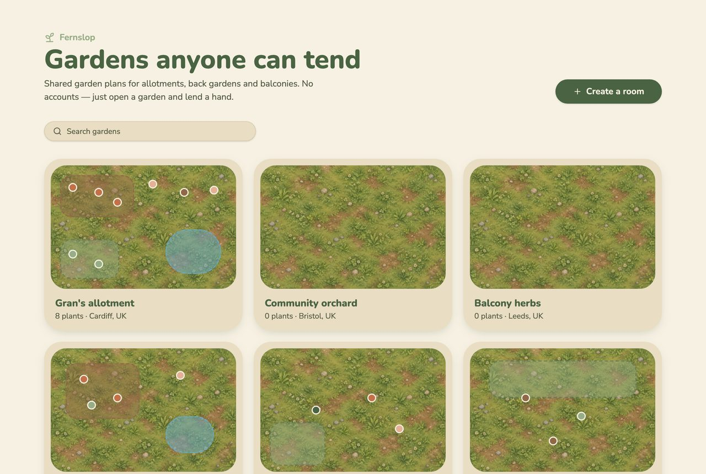
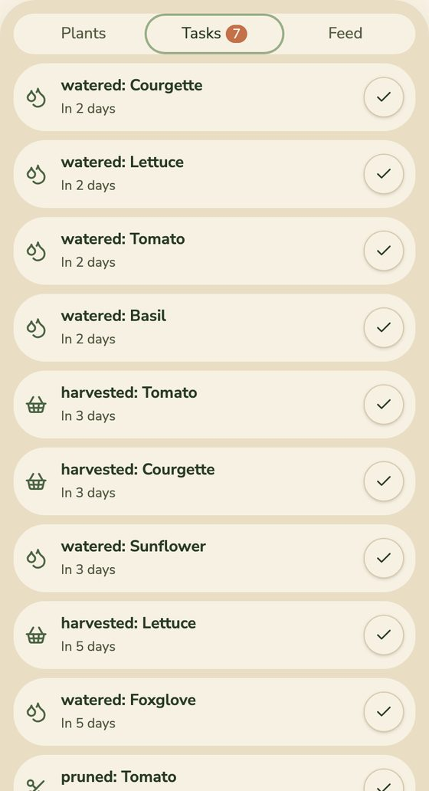
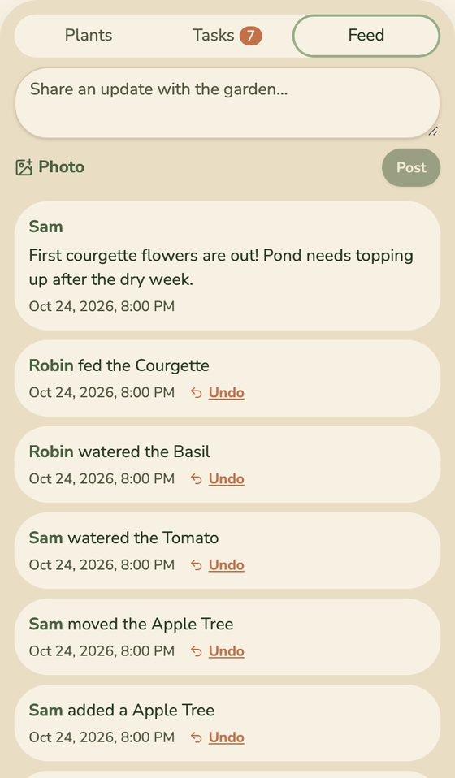
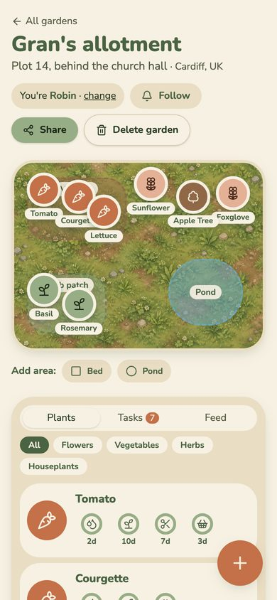

# Product guide

What Fernslop is for, what it does, and how it should behave.

- Full build spec: [`lovable-spec.md`](../_docs/lovable-spec.md)
- First MVP plan, before the scope changed to shared gardens: [`plan.md`](../_docs/plan.md)
- Design system: [`design-system.md`](../_docs/design-system.md)

## The problem

Most gardens are looked after by more than one person. A family shares a back garden. Neighbours share an allotment plot. A street looks after a community orchard.

Between them, nobody has the full picture:

- **What is planted where?** It lives in one person's head, on a scrap of paper, or in a camera roll.
- **What is that plant?** People often don't know its name, so they can't look up how to care for it.
- **What needs doing, and has someone already done it?** The tomatoes get watered twice, or not at all. Nobody knows the pond needs topping up.
- **Getting started is a chore.** Most garden apps want an account from every helper, and each person's plants stay private to them.

## Who it is for

- **Households and groups who share a garden:** families, flatmates, allotment neighbours, community gardens.
- **Beginners** who need plain care guidance and a nudge when something is due.
- **Occasional helpers**, like a neighbour watering while you are away. They should be able to help from a link, with no sign-up.

## The solution

Fernslop gives each real garden **one shared, living plan**. Anyone with the link can see it and edit it, and there are no accounts. Changes show up live for everyone looking at the garden. Every change is recorded in the garden's activity feed, and plant and area changes can be undone, so an open garden is safe to share.

## Features

### Gardens

Anyone can create a garden with a name, an optional description and an optional region. All gardens are listed on the home page, newest activity first, each with a thumbnail of its layout. The home page has a search box to find a garden by name.

### The garden canvas

Each garden is a map of the real space. Plants are round tokens that can be dragged to where they are planted. Labelled areas, such as a **Pond**, a **Veg bed** or a **Herb patch**, mark the parts of the garden. Areas can be added, moved, resized, renamed and deleted.

Positions are stored as percentages, so the layout looks the same on a phone and on a large screen.

### Adding plants: search

The **Add a plant** dialog searches a reference table of about 50 common garden plants: herbs, vegetables, flowers, houseplants, shrubs and trees. It matches common names ("tomato") and scientific names ("Solanum"). The user picks a result to add it.

### Adding plants: photo identification

The user can upload a photo instead. The backend sends it to an identification service (Pl@ntNet) and shows up to 3 likely matches, each with a confidence score. The user confirms the right one. If none fits, **None of these, search instead** opens the search tab.

The photo is used only for identification. It is not stored.

### Care rings and tasks

Each plant shows a countdown ring for each care type its plant data supports: water, feed, prune and harvest. The intervals come from the plant table, and users cannot change them. If the table has no data for a care type, that ring is not shown.

The **Tasks** tab lists all care that is due, soonest first. Ticking a task, or pressing **Mark watered** on a plant, resets its ring and posts to the feed.

### Activity feed and Undo

The **Feed** tab shows everything that happened in the garden, newest first: plants added, moved, removed and cared for, and areas added or changed. People can also post a message, with an optional photo.

Plant and area events have an **Undo** link. Posts cannot be undone.

### Identity without accounts

On first visit, each device gets a random ID and a friendly name, such as "Anonymous Hedgehog". The user can change it ("You're Robin · change"). The feed shows who did what.

### Follow by email

**Follow** asks for an email address. The follower confirms it from a link first (double opt-in). After that, they get a weekly summary when the garden had activity. Every email has a one-click unsubscribe link.

### Delete a garden

**Delete garden** hides the garden at once. It is removed for good after 7 days.

### Works on phones

The layout is mobile first. On a phone the canvas sits on top, with the tabs below and a floating **+** button. Every canvas action can also be done from the plant list, so dragging is not required.

## Expected behaviour

### Gardens

| When the user... | Fernslop... |
| --- | --- |
| Creates a garden | Opens it and offers a share link to copy |
| Opens a shared link | Shows the garden, editable straight away, with no sign-up |
| Searches the home page | Filters the garden list by name |
| Deletes a garden | Hides it from the list and its link at once; removes it for good after 7 days |
| Opens a page that does not exist | Shows "Page not found" with a link home |

### Plants and areas

| When the user... | Fernslop... |
| --- | --- |
| Searches for a plant | Lists matches by common or scientific name; nothing is added until the user picks one |
| Searches for a plant that is not in the table | Shows "No plants match". Repeated misses for the same term raise an alert, so the team can add the plant |
| Uploads a photo to identify | Accepts JPG, PNG or WebP up to 5 MB and shows up to 3 candidates to confirm |
| Uploads a file that is not a supported image | Rejects it with a message, before it is sent |
| Gets no good match from the photo | Says "We couldn't be sure — try searching instead" and offers the search tab |
| Confirms a plant | Places it in the middle of the canvas, ready to drag, and adds a feed event |
| Drags a plant or an area | Saves the new position and shows it to everyone else within a second or two |
| Adds a 51st plant | Shows "This garden is full (50 plants max)" and adds nothing |
| Adds an 11th area | Shows "This garden has the maximum 10 areas" and adds nothing |

### Care

| When the user... | Fernslop... |
| --- | --- |
| Opens a garden | Shows a ring per supported care type, with days left (e.g. "2d") |
| Leaves a task past its due date | Turns the ring terracotta and lists it as "Due now" in Tasks |
| Marks a task done | Resets that ring and adds a feed event |

### Feed and Undo

| When the user... | Fernslop... |
| --- | --- |
| Posts a message, with or without a photo | Adds it to the feed for everyone. Photos over 5 MB are shrunk in the browser first, and photo metadata (such as GPS location) is removed |
| Clicks Undo on a plant or area event | Reverts that change and marks the event "Undone" |
| Clicks Undo on an event that a later change touched | Refuses with "This can't be undone", so a newer change is never lost |
| Clicks Undo twice | Refuses with "Already undone" |

### Following

| When the user... | Fernslop... |
| --- | --- |
| Follows a garden | Sends a confirmation link; nothing else is sent until it is confirmed |
| Does not confirm within 7 days | Deletes the follow |
| Has confirmed, and the garden had activity that week | Sends a weekly summary of tasks due and recent feed events |
| Clicks Unsubscribe in an email | Stops the emails at once |

### Protecting an open app

| When... | Fernslop... |
| --- | --- |
| Someone sends requests too fast (e.g. many uploads) | Answers "You're going a bit fast. Try again in N seconds." The limits are per action, such as 10 gardens an hour or 15 photo uploads a day |
| The live connection drops | Shows a "Reconnecting…" pill and catches up when it is back |
| Two people edit the same garden | Both see each other's changes live; the last write wins |

## Out of scope

- Accounts, logins and private gardens. Open editing is the point; the feed and Undo are the safeguards.
- Chat or direct messages.
- Native mobile apps.
- Moderation tools beyond the feed and Undo.
